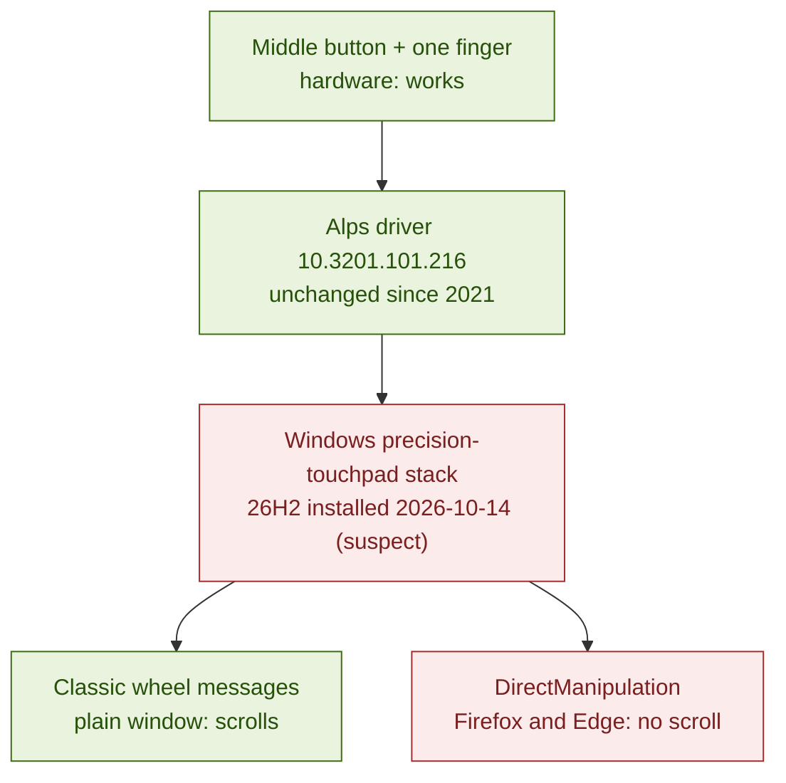

# alps-middle-scroll

On a Dell Latitude, holding the middle button on the pointing-stick row and moving a
finger stopped scrolling in Firefox and Edge. It happened around a Windows 11
feature update. This repo holds the diagnosis, two fixes, and the PowerShell
scripts that found them.

It was worked out on a **Dell Latitude 7490** with the Alps "Dell Touchpad" driver
10.3201.101.216, Windows 11 26H2 (build 26300), and Firefox 158. Other Latitudes
with the Alps dual-point driver (the pointing stick plus three buttons above the
touchpad) probably behave the same way, but that is untested.

## The symptom

You hold the middle button and move a finger on the touchpad, and nothing scrolls
in the browser. It used to work. A plain Windows window still scrolls, and so does
two-finger scrolling.

## What is going on



What was measured:

- In its default scroll mode, the Alps driver swallows the middle-button press.
  Windows never sees a click.
- While the button is held, finger movement still comes out as a stream of wheel
  events. Those events carry no device handle and no "injected" flag, which fits
  Windows synthesizing them from the precision touchpad (inferred).
- A classic window, which receives plain wheel messages, scrolls.
- Firefox and Edge, which both take touchpad panning through Windows
  DirectManipulation, don't.
- Turning DirectManipulation off in Firefox brought the scroll back.

So the scroll is being lost on the DirectManipulation route. Edge failing too rules
out a Firefox-only change. The hardware and the driver files are unchanged. The
Windows 26H2 update is the prime suspect, but the day it broke was never pinned
down, and Windows' touchpad settings key was also written during that period. The evidence and the
open questions are in
[docs/hardware-and-software.md](docs/hardware-and-software.md).

## Fix 1 (recommended): make the middle button a real middle click

```powershell
powershell -ExecutionPolicy Bypass -File .\scripts\Set-StickMiddleButton.ps1 -Mode MiddleClick
```

This changes the Alps setting `SPFunction3` from 16 (scroll mode) to 14 (middle
click), backs up your Alps settings to a `.reg` file in `%TEMP%` first, and
restarts the Alps helper. No admin rights are needed. Confirmed on the test
machine in Firefox:

- Middle-clicking a tab closes it.
- Middle-clicking a page starts Firefox's autoscroll: an icon appears and moving
  your finger scrolls. Holding the button and moving also scrolls, and the scroll
  stops when you let go.

Edge also has middle-click autoscroll, but it is untested with this fix. Undo with
`-Mode Scroll`, or double-click the backup `.reg` file. Move that file somewhere
safer than `%TEMP%` if you want to keep it, because Windows cleans `%TEMP%`.

## Fix 2: take Firefox off DirectManipulation

```powershell
powershell -ExecutionPolicy Bypass -File .\scripts\Set-FirefoxDirectManipulation.ps1 -State Off
```

This writes `apz.windows.use_direct_manipulation = false` into your Firefox
profile's `user.js`, and saves the old file as `user.js.bak`. Restart Firefox
afterwards. The driver's scroll mode then works in Firefox again (confirmed).

It has costs. Two-finger scrolling loses DirectManipulation's native smooth
panning. Firefox's two-finger swipe for back and forward (Firefox 105 and later)
probably stops working too (inferred, not tested). Fix 1 alone is enough: on the
test machine, with Fix 1 in and DirectManipulation back on, both two-finger
back/forward and middle-button autoscroll work. Use Fix 2 only if you want to keep
the driver's scroll mode instead of Fix 1.

Undo with `-State On`. Deleting the lines from `user.js` does not undo it, because
Firefox has already copied the values into `prefs.js`.

## Diagnose your own machine

| Script | What it does | Changes anything? |
|---|---|---|
| `scripts/Get-TouchpadReport.ps1` | Hardware, drivers, Alps processes and settings, touchpad settings, recent updates, Firefox prefs | No |
| `scripts/Watch-MiddleButton.ps1` | Opens a test window: Raw Input logs buttons and wheel per device, and the app-level hook logs middle and wheel messages | No |
| `scripts/Set-StickMiddleButton.ps1` | Fix 1 (supports `-WhatIf`) | Yes, with a `.reg` backup first |
| `scripts/Set-FirefoxDirectManipulation.ps1` | Fix 2, or its undo (supports `-WhatIf`) | Yes, only its own prefs in `user.js`, with a `.bak` copy |

```powershell
powershell -ExecutionPolicy Bypass -File .\scripts\Watch-MiddleButton.ps1
```

The report and the test-window log trim device instance IDs and Bluetooth
addresses, but read them before you share them.

## Docs

- [HANDOFF.md](HANDOFF.md): current status, reading order, possible follow-ups
- [docs/hardware-and-software.md](docs/hardware-and-software.md): the input stack
  piece by piece, the settings involved, and the evidence
- [docs/session-log.md](docs/session-log.md): how the diagnosis went, wrong turns
  included
- [docs/lessons-learned.md](docs/lessons-learned.md): what to do first next time

## License

MIT. The scripts read and write documented Windows and Firefox settings plus one
Alps registry value. No Alps, Dell or Mozilla code is included.
