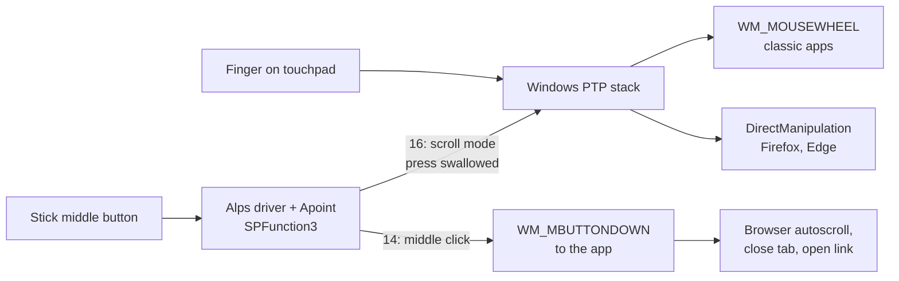

# Hardware and software interactions

Each layer between the middle button and the browser, what was measured there, and
which settings matter. "Observed" means it was measured on the test machine. "Inferred"
means it fits the evidence but nobody documents it.

## The machine

| Layer | Component | Version / state |
|---|---|---|
| Hardware | Dell Latitude 7490, dual-point: pointing stick plus three buttons above the touchpad | n/a |
| Touchpad device | Alps, ACPI `DELL081C` on the Intel Serial IO I2C bus | 5 HID collections, below |
| Touchpad mode | Precision Touchpad (PTP) | Alps registry `PTPModeOn = 1` |
| Vendor driver | "Dell Touchpad" by ALPSALPINE, `oem*.inf` | 10.3201.101.216, dated 2021-05-17 |
| Vendor virtual device | AlpsAlpine Virtual HID Device, `HID\VID_044E&PID_1212` | 10.0.0.126 |
| Vendor user-mode helpers | `Apoint.exe`, `ApntEx.exe`, `ApMsgFwd.exe`, `ApRemote.exe` in `%SystemRoot%\System32\DellTPad`; service `ApHidMonitorService` | running |
| OS | Windows 11 26H2, build 26300 | installed 2026-10-14 16:09, after two failed 25H2 attempts |
| Browser | Firefox 158.0 | installed 2026-10-14 11:29, the same day |
| Browser | Microsoft Edge | used as a control |

HID collections of `DELL081C`:

| Collection | Name in Device Manager | Driver | Role (inferred) |
|---|---|---|---|
| COL01 | HID-compliant mouse | msmouse.inf | stick movement and buttons as a mouse |
| COL02 | HID-compliant touch pad | input.inf (Windows) | the precision touchpad itself |
| COL03 | Dell Touchpad | Alps oem inf | vendor channel that `Apoint` talks to |
| COL04 | HID-compliant vendor-defined device | input.inf | vendor data |
| COL05 | Microsoft Input Configuration Device | input.inf | PTP configuration (Windows) |

The Alps virtual HID device (`VID_044E`) exposes its own mouse and keyboard
collections, which Alps probably uses to send input it synthesizes (inferred). In the
test window, a left click arrived from this device (observed), most likely from the
stick's left button.

## Path of a "hold middle + move finger" scroll

### What was measured

`scripts/Watch-MiddleButton.ps1` listens at two levels at once:

- **Raw Input** (`WM_INPUT`) shows what the input stack delivers and which device sent
  it.
- **A low-level mouse hook** (`WH_MOUSE_LL`) shows the messages apps receive, plus
  whether software injected them (`LLMHF_INJECTED`).

Holding the middle button and moving one finger, with `SPFunction3 = 16` (scroll mode),
**observed**:

- **No middle-button event at all, at either level.** The press never reaches Windows
  as a click.
- **A stream of `WHEEL` events** with small deltas (3 to 533) and inertia tails. Raw
  Input reported no device handle for them, and the hook did not flag them as
  injected. That fits Windows synthesizing them from precision-touchpad input
  (inferred). If Apoint had sent them with `SendInput`, the hook would flag them as
  injected.
- The test window, a classic WinForms window, scrolled.
- Firefox did not scroll, and neither did Edge.

With `SPFunction3 = 14` (middle click), **observed** by the user: middle-click closes a
Firefox tab, a single click brings up Firefox's autoscroll icon, and holding the button
and moving scrolls until the button is released.

### Why Firefox and Edge, and not the test window

Windows can hand precision-touchpad panning to an app in two ways. Apps that don't ask
for anything get classic `WM_MOUSEWHEEL` messages. Apps that register a
DirectManipulation viewport get the panning through DirectManipulation instead, for
native smooth scrolling. Firefox does this by default (`apz.windows.use_direct_manipulation`),
and Chromium browsers such as Edge do too.

After the update, the scroll from the button-held gesture still reaches classic windows
but not DirectManipulation clients. Turning DirectManipulation off in Firefox made the
gesture work there again (observed). So the break is most likely in how Windows
delivers this gesture to DirectManipulation clients (inferred). The hardware and
Firefox are ruled out by the tests above. The Alps driver files are unchanged, though
an interaction between that driver and the new Windows build can't be ruled out.

## Settings that matter

### Alps: `HKCU\Software\Alps\Apoint\Button`

| Value | Seen | Meaning |
|---|---|---|
| `SPFunction1` | 5 | stick left button: click (inferred from the default) |
| `SPFunction2` | 4 | stick right button: right click (inferred) |
| `SPFunction3` | 16, then 14 | stick middle button. 16 = scroll mode, 14 = middle click (observed by changing it) |
| `ButtonFunction3`, `MouFunction3` | 14 | touchpad and external mouse middle button; both 14, which matches "middle click" |

`HKCU\Software\Alps\Apoint\Params\Default` holds the factory values (also
`SPFunction3 = 16`). `Apoint` reads the settings at start, so restart it after a change.
Alps doesn't document these codes.

### Windows: `HKCU\Software\Microsoft\Windows\CurrentVersion\PrecisionTouchPad`

Build 26300 has values that older builds don't: `SingleFingerPanMode` (single-finger
edge scrolling), `EdgeAutoPanningEnabled`, `BoostedPanningEnabled` (accelerated
scrolling), and `PanSensitivity`. On the test machine they read 1, 0, 0 and 30. This key
was last written on 2026-10-18 at 09:54, after the update and before the diagnosis.
Whether that was the owner changing a touchpad setting, and whether it played a part,
is unknown.

### Firefox: `about:config`

| Pref | Default | Effect |
|---|---|---|
| `apz.windows.use_direct_manipulation` | true | take precision-touchpad panning through DirectManipulation |
| `apz.windows.force_disable_direct_manipulation` | false | showed up as `true` in `prefs.js` after the restart with the pref above set to false. Where it came from is unknown |
| `general.autoScroll` | true on Windows | middle-click autoscroll, which Fix 1 relies on |

`prefs.js` only stores prefs that differ from the default. Before the fix it had no
`apz` line, so DirectManipulation was simply on by default.

## Still open

- **What triggered it.** Both Firefox 158 and Windows 26H2 arrived on 2026-10-14. Edge
  failing too points at Windows, but nobody recorded the day the gesture stopped
  working, and the touchpad settings key changed on 2026-10-18.
- **Whether Fix 2 breaks Firefox's two-finger swipe for back and forward.** Firefox has
  shipped that gesture on Windows since version 105, and it probably relies on
  DirectManipulation's pan gestures (inferred). Untested. It is settled that Fix 2
  isn't needed: with Fix 1 in and DirectManipulation back on, both the swipe and
  middle-button autoscroll work (user confirmed).
- **Whether Edge works with Fix 1.** Chromium has middle-click autoscroll on Windows, so
  it probably does. Untested.
- **Other Alps function codes.** Only 14 and 16 were tested on the middle button.
